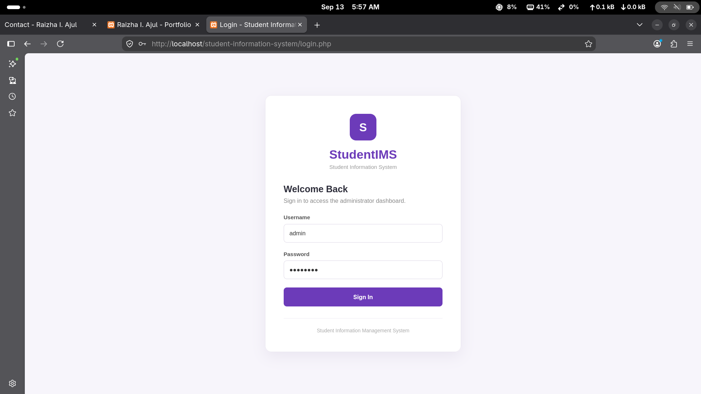
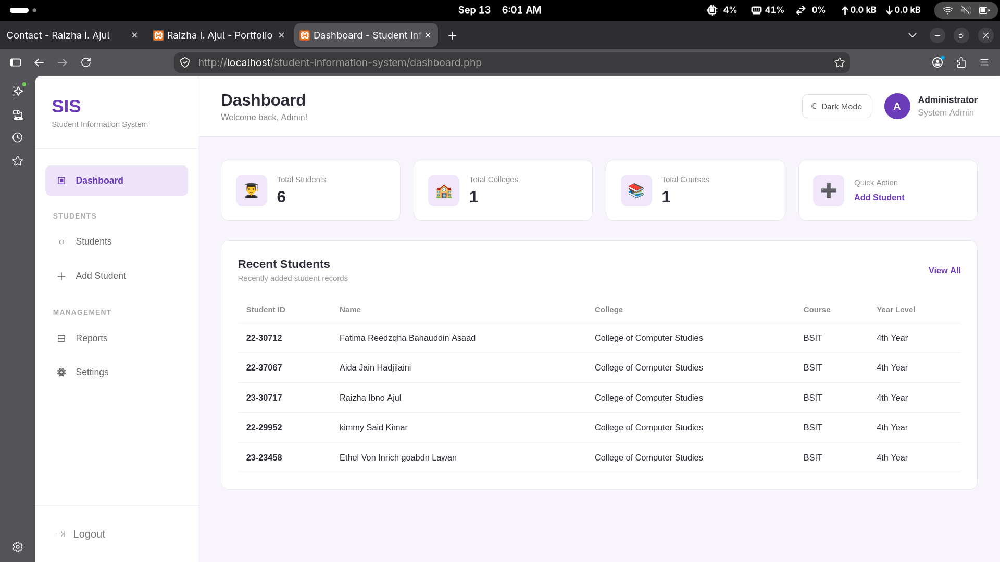
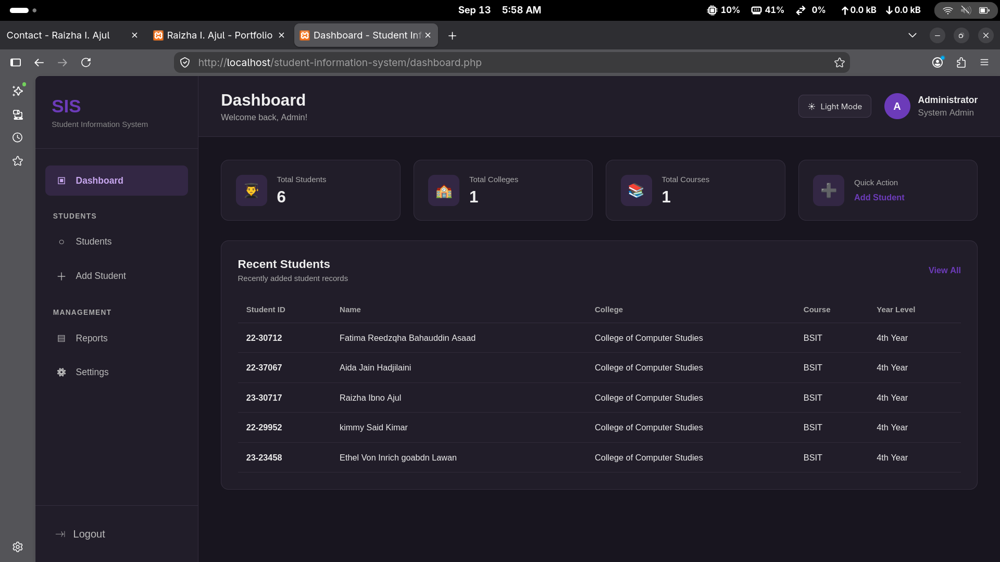
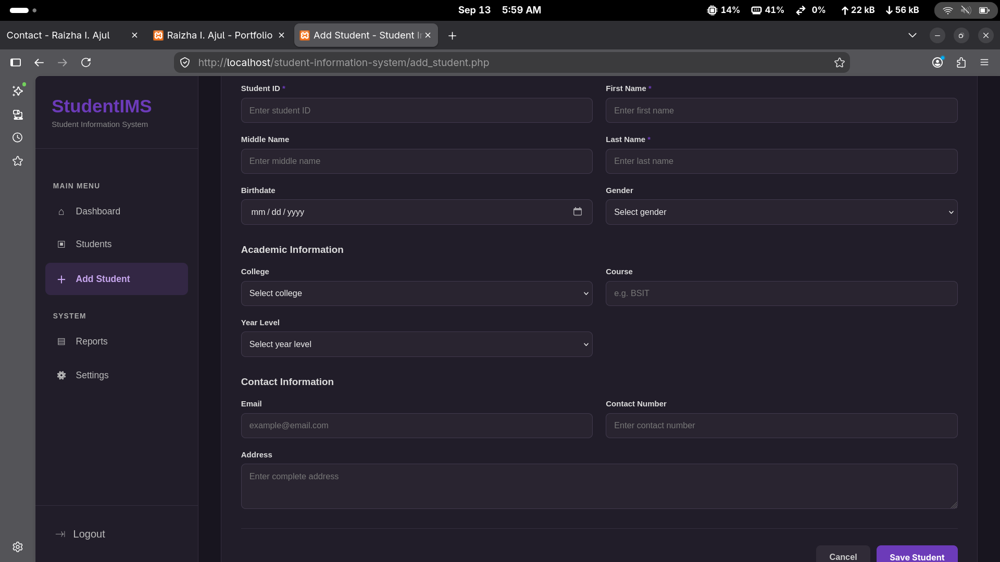
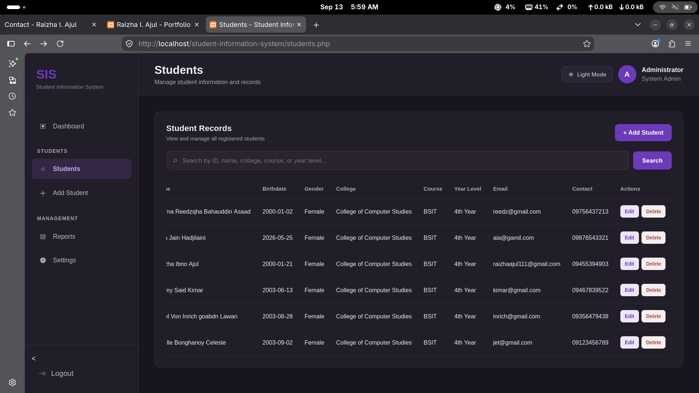
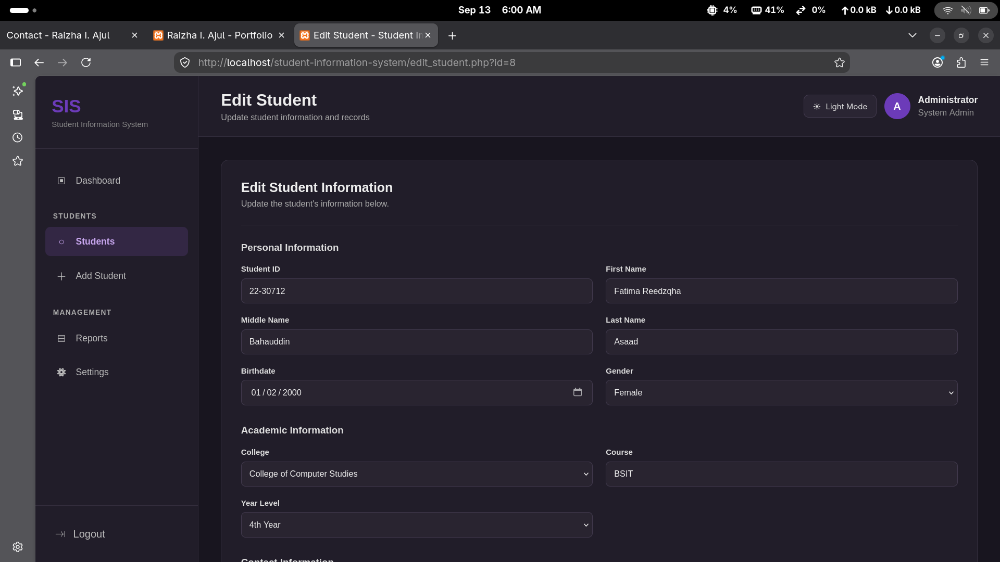
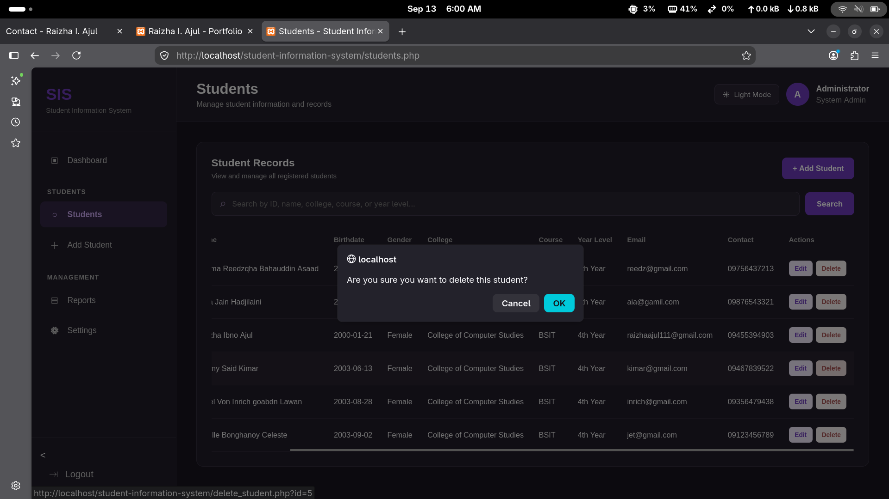

# Student Information System

A simple web-based **Student Information System (SIS)** developed to manage student records. The system allows administrators to log in, view student information, add new students, edit records, delete records, and search for students.

### Technologies Used

* **PHP** – backend and system functionality
* **MySQL** – database for storing student records
* **HTML5** – page structure
* **CSS3** – layout and design
* **JavaScript** – Light/Dark Mode functionality
* **XAMPP** – local development server
* **phpMyAdmin** – database management

## Screenshots

